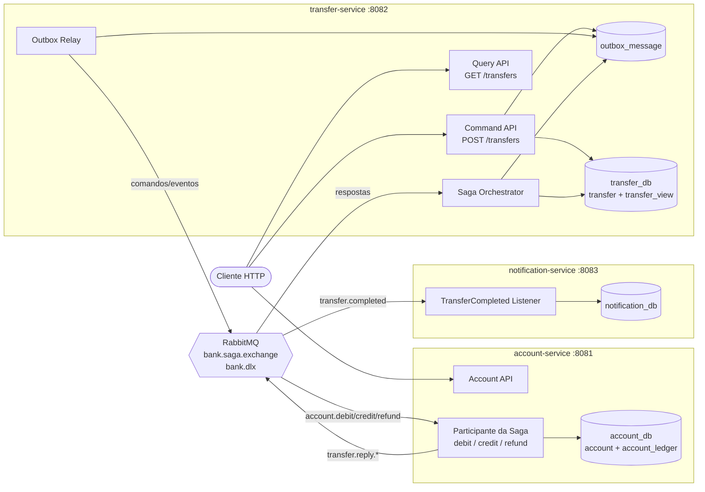
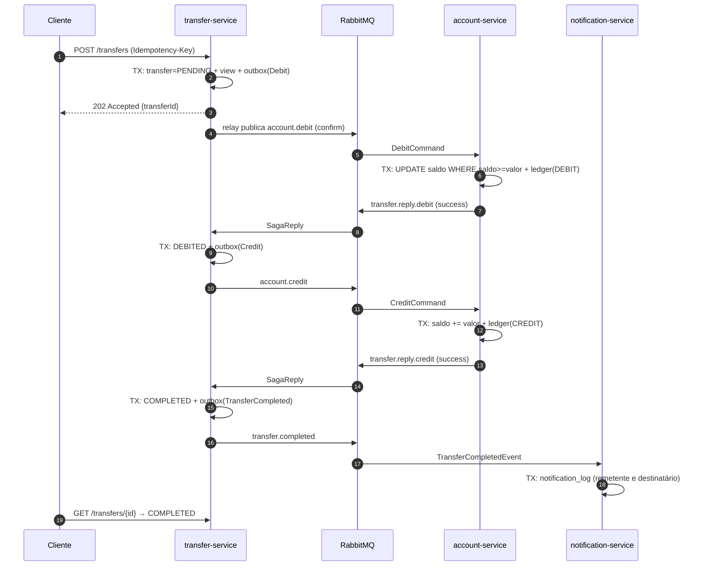
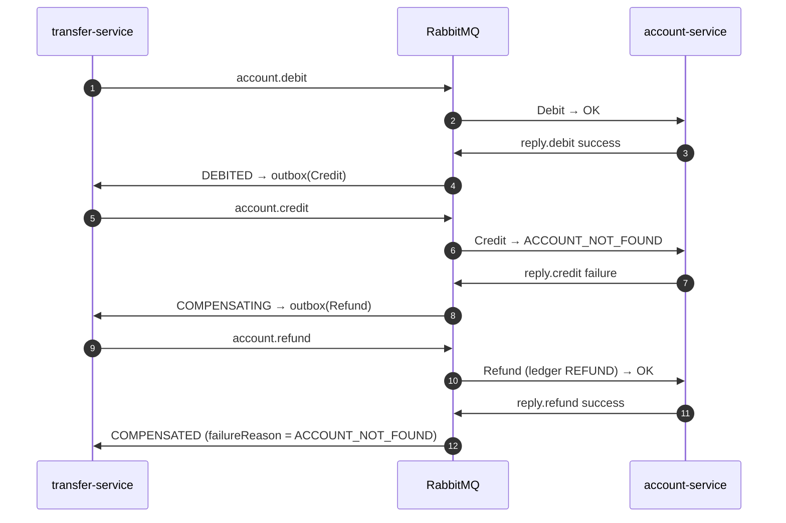
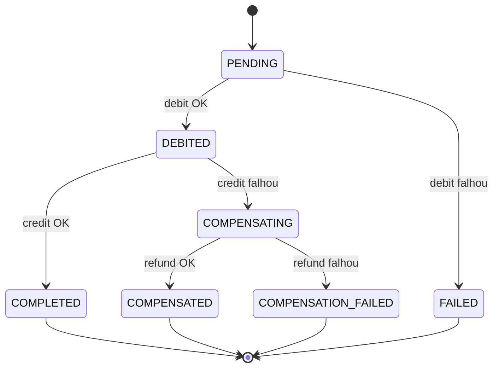
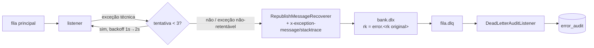

# Arquitetura — Banco Digital

## Visão geral

## Sequência — caminho feliz

## Sequência — compensação (conta destino inexistente)

## Máquina de estados da Saga

## Topologia RabbitMQ

| Fila | Dono | Binding em `bank.saga.exchange` | DLQ (binding em `bank.dlx`) |
|---|---|---|---|
| `account.debit.command.q` | account | `account.debit` | `account.debit.command.q.dlq` (`error.account.debit`) |
| `account.credit.command.q` | account | `account.credit` | `account.credit.command.q.dlq` (`error.account.credit`) |
| `account.refund.command.q` | account | `account.refund` | `account.refund.command.q.dlq` (`error.account.refund`) |
| `transfer.saga.reply.q` | transfer | `transfer.reply.#` | `transfer.saga.reply.q.dlq` (`error.transfer.reply.#`) |
| `notification.transfer-completed.q` | notification | `transfer.completed` | `notification.transfer-completed.q.dlq` (`error.transfer.completed`) |

### Caminho de uma mensagem com falha

Falhas de **negócio** (saldo insuficiente, conta inexistente) não são exceções: viram uma resposta
`success=false` e seguem o fluxo normal da Saga — nunca vão para a DLQ.
