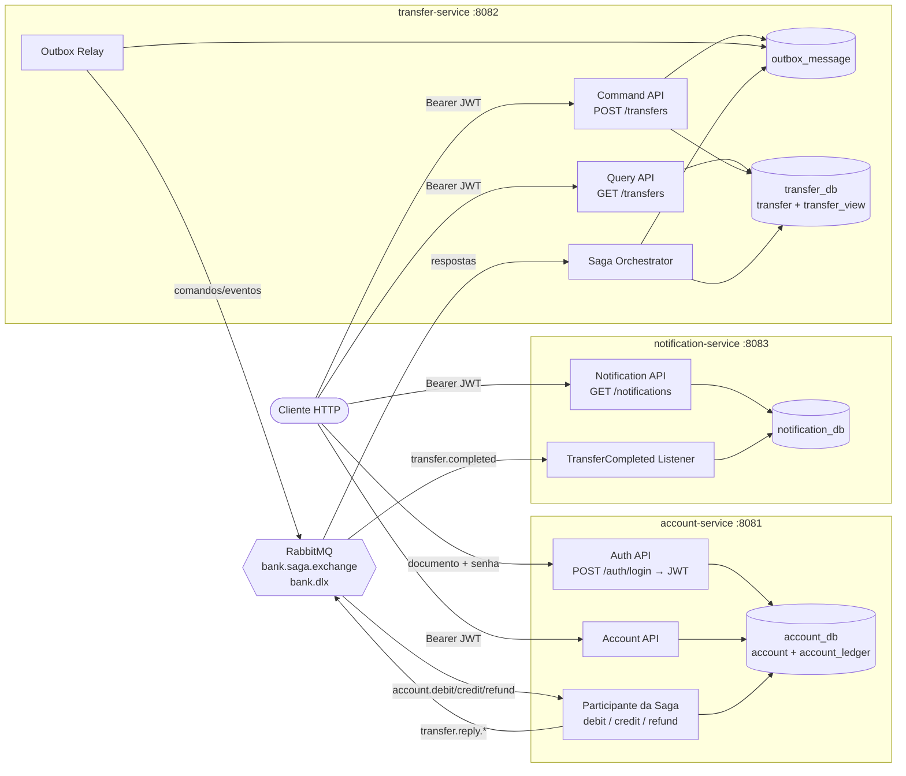
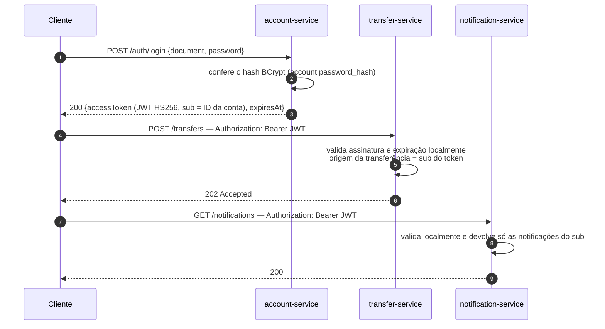
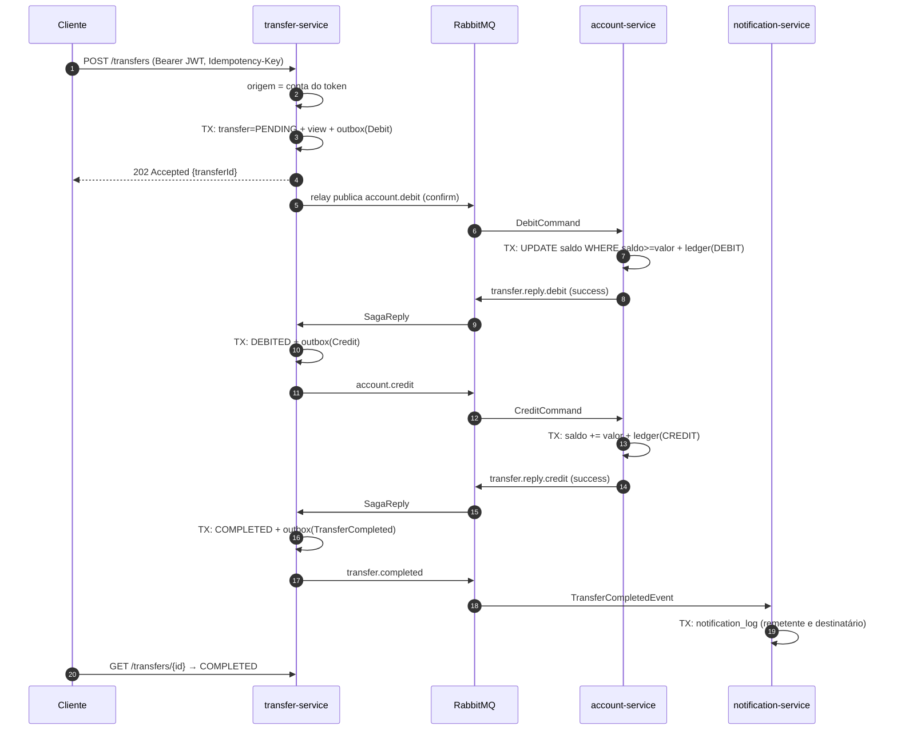
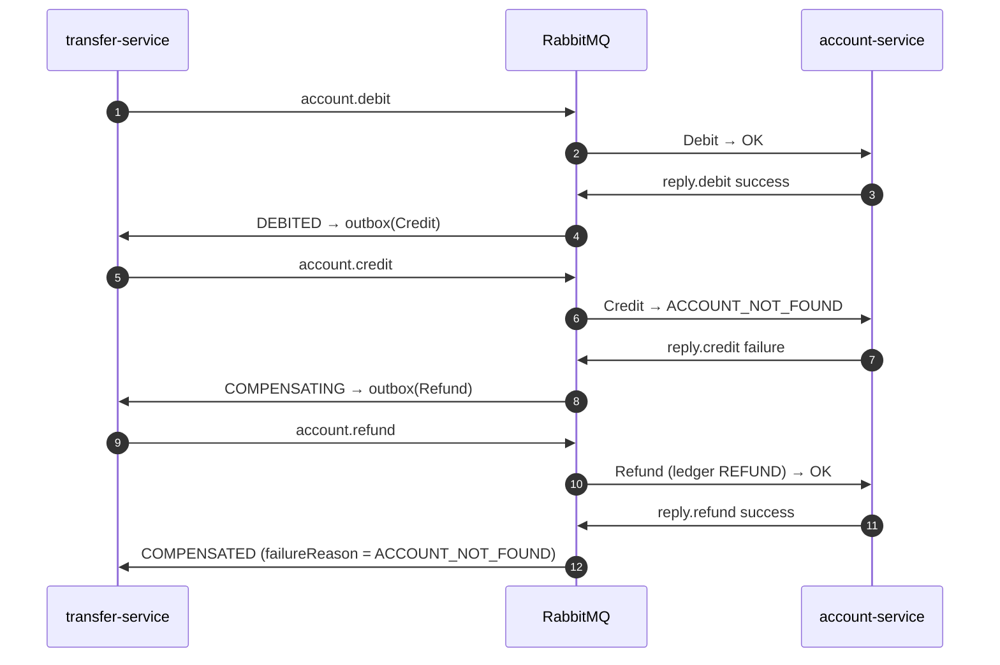
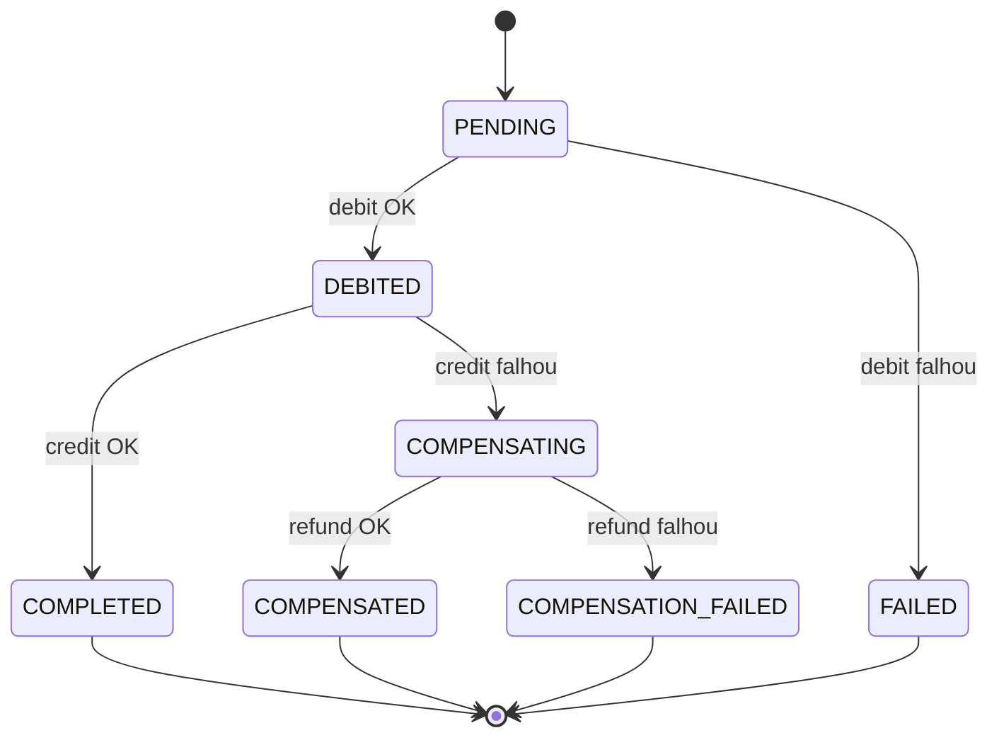
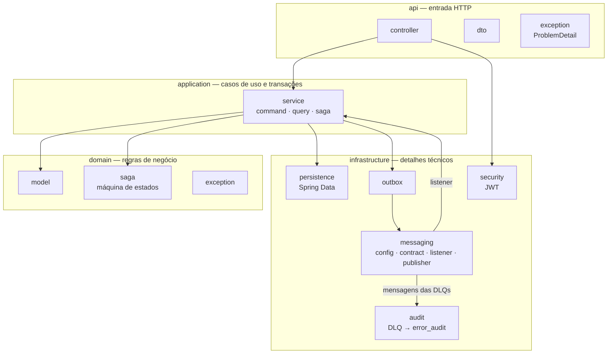
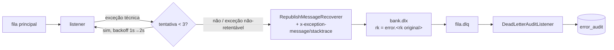

# Arquitetura — Banco Digital

## Visão geral

Os serviços **não se chamam por HTTP**: toda comunicação entre eles passa pelo RabbitMQ. O JWT é validado
localmente em cada serviço com o segredo compartilhado `BANK_JWT_SECRET`.

## Autenticação e autorização

| Situação | Resposta |
|---|---|
| Sem token, token inválido ou expirado | `401` |
| Documento ou senha errados no login (mesma mensagem nos dois casos) | `401` |
| Informar no pedido uma conta que não é a do token (`fromAccountId`, `accountId`, `/accounts/{id}`) | `403` |
| Consultar transferência da qual não é remetente nem destinatário | `404` (não revela que o ID existe) |
| Rotas públicas | `POST /auth/login`, `POST /accounts`, Swagger, `/actuator/**` |

## Sequência — caminho feliz

## Sequência — compensação (conta destino inexistente)

## Máquina de estados da Saga

A decisão de transição é a função pura `TransferSaga.decide(status, SagaStep, sucesso)` (pacote
`domain/saga`). O `TransferSagaOrchestrator` (pacote `application/saga`) traduz a resposta recebida
(`SagaReply.operation`) para `SagaStep`, aplica a transição e grava o próximo comando no outbox. Respostas
duplicadas ou fora de ordem são ignoradas.

## Camadas do código

Os três serviços têm a mesma organização de pacotes (`com.digitalbank.<serviço>`):

O `domain` não importa nada das outras camadas. Exemplo no fluxo de transferência:

| Camada | Classes |
|---|---|
| `api` | `TransferCommandController`, `TransferQueryController`, `TransferDtos`, `ApiExceptionHandler` |
| `application` | `TransferCommandHandler`, `TransferSagaOrchestrator`, `TransferQueryService`, `TransferProjector`, `TransferView` |
| `domain` | `Transfer`, `TransferStatus`, `TransferSaga`, `SagaStep` |
| `infrastructure` | `TransferRepository`, `OutboxService`, `OutboxRelay`, `SagaReplyListener`, `ReliablePublisher`, `RabbitConfig`, `SecurityConfig`, `DeadLetterAuditListener` |

## Topologia RabbitMQ

| Fila | Dono | Binding em `bank.saga.exchange` | DLQ (binding em `bank.dlx`) |
|---|---|---|---|
| `account.debit.command.q` | account | `account.debit` | `account.debit.command.q.dlq` (`error.account.debit`) |
| `account.credit.command.q` | account | `account.credit` | `account.credit.command.q.dlq` (`error.account.credit`) |
| `account.refund.command.q` | account | `account.refund` | `account.refund.command.q.dlq` (`error.account.refund`) |
| `transfer.saga.reply.q` | transfer | `transfer.reply.#` | `transfer.saga.reply.q.dlq` (`error.transfer.reply.#`) |
| `notification.transfer-completed.q` | notification | `transfer.completed` | `notification.transfer-completed.q.dlq` (`error.transfer.completed`) |

### Caminho de uma mensagem com falha

Falhas de **negócio** (saldo insuficiente, conta inexistente) não são exceções: viram uma resposta
`success=false` e seguem o fluxo normal da Saga — nunca vão para a DLQ.
